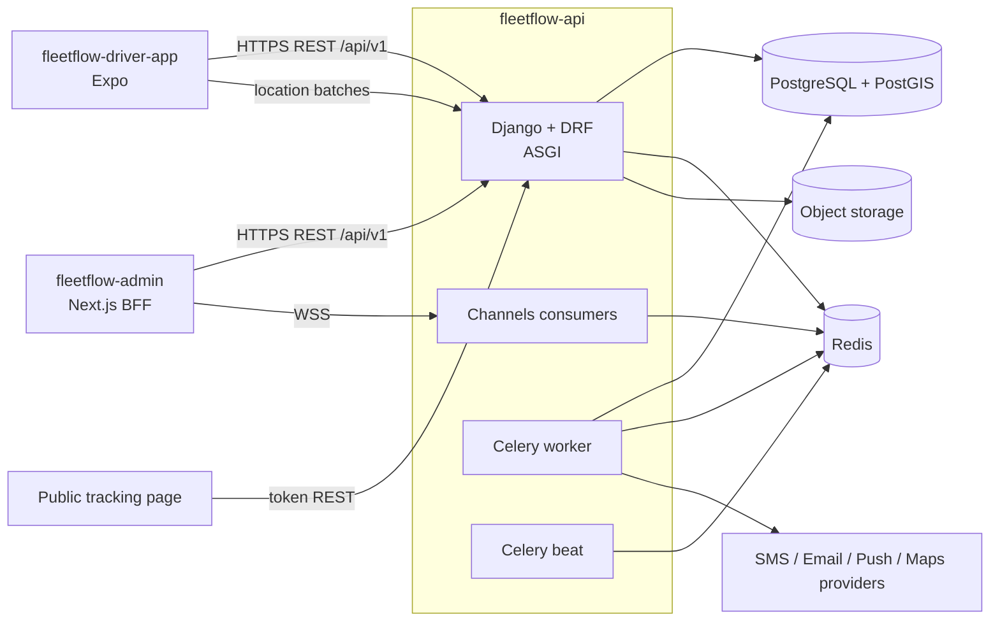
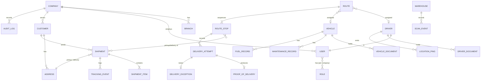
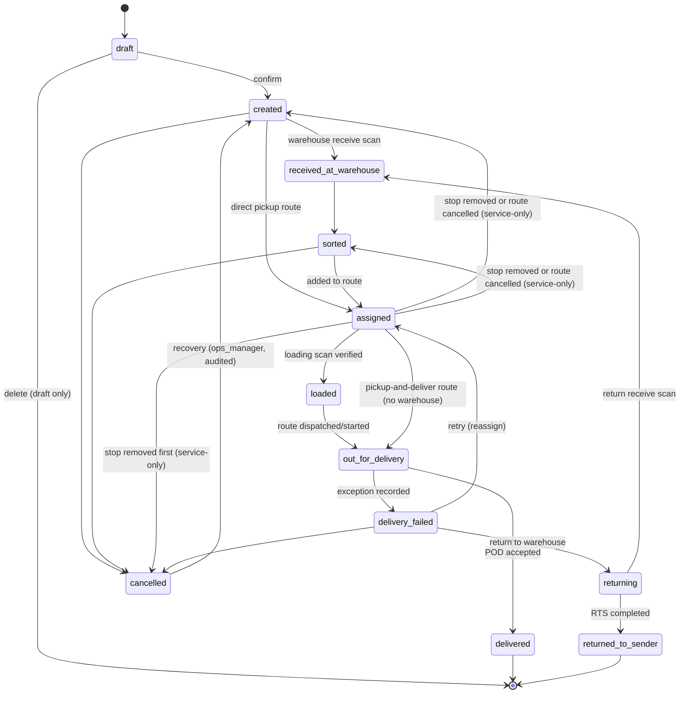

# fleetflow-api: Architecture

Status legend: **APPROVED** = owner-approved · **PROPOSED** = recommended, awaiting approval · **NEEDS APPROVAL** = open choice, owner must decide · **FUTURE** = not in MVP.

> The owner approved the Phase 0 docs on 2026-11-22. Items still marked PROPOSED are recommendations that have not been individually approved.
> Research date: **2026-11-21**. Versions were taken from the PyPI JSON API and package classifiers on that date. Re-verify at Phase 0 kickoff.

## Table of contents

1. [Responsibilities](#1-responsibilities)
2. [Technology](#2-technology)
3. [Architecture style](#3-architecture-style)
4. [Project structure](#4-project-structure)
5. [Module boundaries](#5-module-boundaries)
6. [API conventions](#6-api-conventions)
7. [Authentication & tokens](#7-authentication--tokens)
8. [Authorization (RBAC)](#8-authorization-rbac)
9. [Tenant isolation](#9-tenant-isolation)
10. [Data model](#10-data-model)
11. [Shipment lifecycle](#11-shipment-lifecycle)
12. [Tracking events](#12-tracking-events)
13. [Routes, stops & assignments](#13-routes-stops--assignments)
14. [Warehouse](#14-warehouse)
15. [Proof of delivery & exceptions](#15-proof-of-delivery--exceptions)
16. [Geospatial & GPS](#16-geospatial--gps)
17. [Real-time](#17-real-time)
18. [Background jobs & notifications](#18-background-jobs--notifications)
19. [File storage & uploads](#19-file-storage--uploads)
20. [Idempotency, concurrency, rate limiting](#20-idempotency-concurrency-rate-limiting)
21. [Errors, logging, observability](#21-errors-logging-observability)
22. [Performance & caching](#22-performance--caching)
23. [Security](#23-security)
24. [Environments, config, backup](#24-environments-config-backup)
25. [Cross-app contracts](#25-cross-app-contracts)
26. [Testing architecture](#26-testing-architecture)
27. [MVP vs future](#27-mvp-vs-future)

---

## 1. Responsibilities

fleetflow-api owns: authentication and authorization; companies (tenants), branches and users; roles and permissions; customers and addresses; shipments, shipment items and tracking events; drivers, vehicles and their documents; routes, route stops, dispatch and assignments; warehouse receiving, sorting, staging and loading; delivery exceptions; proof of delivery; GPS/location processing; maintenance and fuel; notifications; invoices and charges; reporting APIs; audit logs; and external integrations.

It is the **only** place where business rules and permissions are enforced. fleetflow-admin and fleetflow-driver-app are untrusted clients.

## 2. Technology

| Concern        | Choice                                          | Version (2026-11-21)             | Status         | Notes                                                                                                 |
| -------------- | ----------------------------------------------- | -------------------------------- | -------------- | ----------------------------------------------------------------------------------------------------- |
| Language       | Python                                          | 3.14                             | APPROVED       | Owner decision 2026-11-22 (memory D-API-10): stdlib `uuid.uuid7()` for public IDs; all deps have wheels |
| Framework      | Django                                          | **5.2 LTS** (5.2.19 installed)   | APPROVED       | See decision D-API-1                                                                                  |
| API            | Django REST Framework                           | 3.18.3                           | PROPOSED       | Classifiers cover Django 5.2–6.1                                                                      |
| OpenAPI        | drf-spectacular                                 | 0.30.0                           | PROPOSED       | Generates the OpenAPI 3 schema that is the contract for admin and driver-app                          |
| Auth tokens    | djangorestframework-simplejwt                   | 5.5.1                            | PROPOSED       | Classifiers stop at Django 5.2. Another reason for 5.2 LTS                                            |
| Filtering      | django-filter                                   | 26.2                             | PROPOSED       |                                                                                                       |
| DB             | PostgreSQL 18 + PostGIS 3.6                     | image `postgis/postgis:18-3.6`   | PROPOSED       | GeoDjango engine `django.contrib.gis.db.backends.postgis` since Phase 2 (GDAL/GEOS from Debian `gdal-bin` in the image and CI); before that a plain engine (memory D-API-8) |
| DB driver      | psycopg 3                                       | 3.3.9                            | PROPOSED       |                                                                                                       |
| Cache/broker   | Redis                                           | 7.x/8.x server; `redis` py 8.1.0 | PROPOSED       | Celery broker, cache, rate-limit counters, Channels layer                                             |
| Jobs           | Celery                                          | 5.7.0                            | PROPOSED       | Celery beat for schedules                                                                             |
| Realtime       | Django Channels + channels-redis                | 4.3.2 / 4.3.0                    | PROPOSED       | See §17                                                                                               |
| ASGI server    | uvicorn (behind gunicorn workers or standalone) | 0.54.0 / gunicorn 27.0.1         | PROPOSED       |                                                                                                       |
| Object storage | S3-compatible through boto3 (no django-storages) | boto3 1.44.10; local server SeaweedFS 4.55 | APPROVED | Owner decision 2026-11-24 (memory D-API-25). Files never pass through Django `FileField`s, so django-storages would add only a presigned-GET helper; the one module touching boto3 is `core/storage.py`. Local and CI server: SeaweedFS (MinIO images are unmaintained, D-API-9); production is any S3 service, configured by `S3_*` env vars |
| Config         | django-environ                                  | 0.14.0                           | PROPOSED       |                                                                                                       |
| Logging        | structlog                                       | 26.1.0                           | PROPOSED       | JSON logs                                                                                             |
| Errors/APM     | sentry-sdk                                      | 2.75.0                           | PROPOSED       | Requires a vendor account. NEEDS APPROVAL for paid tier                                               |
| Lint/format    | ruff                                            | 0.17.6                           | PROPOSED       |                                                                                                       |
| Types          | mypy (+ django-stubs 5.2.x)                     | 1.19.1                           | PROPOSED       | Held below 2.x by django-stubs 5.2 `compatible-mypy`                                                  |
| Containers     | Docker + Compose                                | —                                | PROPOSED       | Development parity: api, worker, beat, postgres-postgis, redis, storage (SeaweedFS, since Phase 3)    |
| Packaging      | uv                                              | 0.12.1                           | PROPOSED       | `pyproject.toml` + `uv.lock`; also used in Dockerfile and CI (memory D-API-7)                         |

**D-API-1 (APPROVED 2026-11-22): Django 5.2 LTS.** Recommendation: 5.2 LTS (security support until April 2028). simplejwt and django-storages declare support only up to 5.2/5.1. DRF, Channels, pytest-django and django-filter all support 5.2. Alternative: 6.1, after confirming the simplejwt and storages CI matrices. Upgrading from 5.2 to 6.x later is a planned Phase 11 or post-MVP task.

## 3. Architecture style

**Modular monolith** (PROPOSED): one Django project and one deployable image, run as three process types (web/ASGI, Celery worker, Celery beat). Modules are Django apps with explicit public interfaces.

Why not microservices: one team, a shared transactional core (a shipment's status, stop and POD must change atomically), and no independent scaling need yet. A second service would add network failure modes with no benefit. Revisit only if GPS ingestion volume demands separate scaling (see §16, FUTURE).



## 4. Project structure

```text
fleetflow-api/
├── config/                 # settings/{base,local,test,production}.py, urls, asgi, wsgi, celery
├── apps/
│   ├── core/               # base models (TimeStamped, PublicId), errors, request ID, app version, pagination, idempotency, object-store client (storage.py)
│   ├── accounts/           # users, auth, roles, permissions
│   ├── tenancy/            # companies, branches, tenant context (TenantScopedModel, TenantQuerySet)
│   ├── customers/          # customers, business accounts, addresses
│   ├── shipments/          # shipments, items, status machine, tracking events
│   ├── uploads/            # presigned uploads: verify, strip metadata, attach (Phase 3)
│   ├── fleet/              # drivers, vehicles, documents, availability
│   ├── dispatch/           # routes, stops, assignments, manifests
│   ├── warehouse/          # warehouses, receiving, sorting, staging, loading scans
│   ├── delivery/           # attempts, POD, OTP, exceptions, returns
│   ├── tracking/           # GPS ingestion, last-known location, ETA, public tracking
│   ├── maintenance/        # maintenance, fuel, costs, alerts            (Phase 8)
│   ├── notifications/      # templates, outbox, providers                (Phase 9)
│   ├── integrations/       # webhooks, external APIs                     (Phase 9)
│   ├── billing/            # charges, invoices, COD reconciliation       (FUTURE)
│   ├── reporting/          # KPI queries, exports                        (Phase 10)
│   └── audit/              # audit log
├── tests/                  # cross-module integration and e2e API tests
└── docker/ compose.yaml pyproject.toml
```

Inside each app: `models.py`, `services.py` (writes and business rules), `selectors.py` (tenant-scoped reads), `serializers.py`, `views.py`, `permissions.py`, `urls.py`, `tasks.py`, `tests/`, `factories.py`. Create these files only when they are needed.

## 5. Module boundaries

- Views stay thin: parse, authorize, call a service or selector, serialize.
- **Services** own all writes, transactions and state transitions. Other apps call a module's services and selectors, never its models' `.save()` directly.
- Cross-module side effects use `transaction.on_commit` plus Celery tasks or the outbox (§18), not Django signals for business logic.
- Dependency direction: `core ← tenancy ← audit ← accounts ← uploads ← (customers, fleet) ← shipments ← (dispatch, warehouse, delivery, tracking) ← (reporting, notifications, integrations)`. Cycles are a review failure. `audit` references users only through `settings.AUTH_USER_MODEL` and takes `actor` as an object, so it never imports `accounts`. `TenantScopedModel` lives in `tenancy` (not `core`) because it references `Company`.

## 6. API conventions

- **Versioning**: URL prefix `/api/v1/`. Breaking change → `/api/v2/` for that resource, with the old version kept for at least one driver-app release cycle (mobile clients update slowly).
- **Resources**: plural kebab-case nouns (`/shipments/`, `/route-stops/`). Actions that are state transitions are explicit sub-resources: `POST /shipments/{id}/transitions/` with `{ "to": "out_for_delivery", "reason": ... }`, not a raw `PATCH status`.
- **IDs**: UUIDv7 public IDs, so they are not enumerable. Integer primary keys stay internal. Human references use `FF-<branch>-<seq>` tracking numbers.
- **Pagination**: cursor pagination by default (`?cursor=`, `page_size` ≤ 100, default 25). Limit/offset only for admin tables that need page numbers (capped at 10k offset).
- **Filtering and sorting**: `?status=in_transit&status=assigned&created_after=…&ordering=-created_at`. Order only by whitelisted fields.
- **Field casing**: `snake_case` JSON. Timestamps are ISO-8601 UTC with `Z`. Money is a decimal string plus an ISO-4217 `currency`. Weights are in kg and dimensions in cm, both as decimal strings.
- **Errors** use one envelope, in the spirit of RFC 9457:

```json
{
  "type": "validation_error",
  "title": "Invalid input",
  "status": 400,
  "code": "shipment.invalid_weight",
  "detail": "Weight must be > 0 and ≤ 30000 kg.",
  "errors": { "weight_kg": ["must be greater than 0"] },
  "request_id": "…"
}
```

- **Documentation**: drf-spectacular serves `/api/schema/` and `/api/docs/` only where `API_DOCS_ENABLED` is true (local). There is no staff concept (memory D-API-12), so production serves no docs; clients use the committed schema, which CI regenerates and diffs (§25).

## 7. Authentication & tokens

| Client               | Mechanism (PROPOSED)                                                                                                                                                                  |
| -------------------- | ------------------------------------------------------------------------------------------------------------------------------------------------------------------------------------- |
| fleetflow-admin      | Login through the Next.js server (BFF). Access and refresh JWTs are stored in **httpOnly, Secure, SameSite=Lax cookies set by the Next.js server**. The browser never sees raw tokens |
| fleetflow-driver-app | JWT access token (15 min) plus refresh token (30 days, rotating), stored in `expo-secure-store`                                                                                       |
| Public tracking      | Opaque, unguessable tracking token per shipment (≥128-bit). Read-only, limited fields, revocable                                                                                      |
| Integrations         | Per-company API keys, hashed at rest and scoped (FUTURE, Phase 9)                                                                                                                     |

- **Sessions (implemented Phase 1)**:
  - Each login creates a `TokenFamily` (one per device), and every token carries its ID in the `fam` claim.
  - Refresh tokens rotate on every use. Each one is tracked by `jti` in `RefreshTokenRecord`; the token itself is never stored, so a database read cannot be replayed as a session. simplejwt is used only to sign and verify tokens; its `token_blacklist` app is not installed, because it stores full tokens.
  - Presenting a rotated refresh token within **30 s** returns a fresh pair in the same family. This covers lost responses and concurrent refreshes on mobile networks. After 30 s it is treated as theft: the family is revoked and the event audited as `auth.refresh_reuse`.
  - Authentication loads the user *through* a non-revoked family, in one query. So logout (that device only), reuse detection and password reset (all devices) end access tokens immediately, not after their 15-minute lifetime.
  - Disabled users (`auth.user_disabled`) and suspended companies (`auth.company_suspended`) are rejected on every request.
  - A daily Celery beat task purges expired token records.
- Login is rejected for: a disabled user or a suspended company. A driver without an active driver profile can still log in (`accounts` cannot import `fleet`, §5, and login must not reveal fleet data); instead **every endpoint of the signed-in driver** (`/me/driver/`, `/me/shift/*`) answers 403 `driver.profile_inactive` when the profile is missing or archived (memory D-API-25, D-API-28). The driver app shows "contact dispatch" on that code.
- Brute-force protection: a per-IP+email login throttle, plus a cross-IP lockout per email (§20). Lockout counts unknown emails too, so it never reveals which accounts exist. Login answers `auth.user_disabled` and `auth.company_suspended` only after the password is verified.
- Password reset sends a single-use, time-limited token by email. The response never reveals whether the account exists.
- **D-API-2 (APPROVED 2026-11-22)**: the admin uses JWT through the Next.js BFF in httpOnly cookies (consistent with mobile), so there is one auth code path in the API. Rejected alternative: Django session cookies with CSRF.

## 8. Authorization (RBAC)

- Roles are per company: `owner`, `admin`, `ops_manager`, `dispatcher`, `fleet_manager`, `warehouse_staff`, `finance`, `customer_service`, `driver`, `viewer`. Custom roles are FUTURE.
- Permissions are codenames like `shipments.create` or `dispatch.assign_driver`. Roles map to permission sets in the DB, seeded by a data migration.
- **Branch scope**: users can be limited to branches. Selectors filter by the user's branch set unless they have the `*.all_branches` permission.
- **Branch scope**: `accounts.selectors.branches_in_scope(user, all_branches_permission)` is the one implementation (all of the company's branches with the permission, otherwise the user's own). Shipments call it with `shipments.all_branches` (Phase 2) and fleet with `fleet.all_branches` (Phase 3); routes reuse it in Phase 4. A driver or vehicle belongs to a home branch, and another branch's one answers 404.
- **Branches API**: `GET /branches/` lists the branches a caller can pick in create forms (their own, or the whole company with any `*.all_branches` permission); `POST /branches/` (`branches.manage`: owner, admin) adds one, with the code upper-cased and name and code unique per company (409 `branch.duplicate`). The creator is not made a member.
- **Implementation (Phase 1)**: views declare `required_permissions = {method: codename}` and use `HasRequiredPermission` after `IsAuthenticated`. An implemented but unmapped method is denied; an unimplemented one gets 405. Effective permissions are loaded once per request and never cached across requests.
- **Object rules** live in DRF permission classes plus service-level checks (defence in depth). For example, a driver can only touch stops on routes assigned to them.
- Every check is server-side. The client UI hides actions as a convenience only.

## 9. Tenant isolation

- **Strategy (PROPOSED)**: shared database, shared schema, with a `company_id` foreign key on every tenant-owned table. Alternatives: schema-per-tenant (django-tenants) is heavier on migrations and has low value at this scale; database-per-tenant is too expensive. Revisit if enterprise isolation is ever sold (FUTURE).
- `TenantScopedModel` base plus a `TenantQuerySet.for_company(company)`. Selectors **must** start from the tenant-scoped manager. The unscoped `.objects` is used only in migrations, admin tooling and tests.
- The tenant comes from the authenticated user's company, **never** from a request parameter or header.
- Cross-tenant ID guessing returns **404** (not 403), so record existence is not leaked.
- Uniqueness constraints include `company_id` (e.g. `UNIQUE(company_id, external_reference)`).
- PostgreSQL Row-Level Security as a second layer is FUTURE and needs measurement.
- A CI test runs every list and detail endpoint as a user of company B against data owned by company A (§26).

## 10. Data model

Core entities and relationships (MVP subset bolded):



Principles:

- Every table has `id` (bigint, internal), `public_id` (UUIDv7) where it is exposed, `created_at` and `updated_at`. Tenant tables also have `company_id`.
- Use DB constraints over app-only checks: `CHECK (weight_kg > 0)`, unique constraints, FK `on_delete=PROTECT` for business records.
- **Soft delete** (`archived_at`) for master data: customers, addresses, drivers, vehicles, users (deactivate) and warehouses. Archived rows stay referenced by history. **Hard delete** is never used for shipments, tracking events, POD, scans, audit logs or financial records. Drafts are the exception: a shipment in `draft` can be hard-deleted, and the deletion is audited.
- `ShipmentItem` holds weight, dimensions, quantity and a barcode (one per parcel). The shipment's total weight is computed and cached.
- Addresses store normalized fields plus `location` (PostGIS `PointField`, SRID 4326) and a geocode-confidence field.
- **Company settings (Phase 2)**: `Company.currency` (ISO 4217, validated against the circulating-currency list) and `Company.timezone` (IANA). `Branch.code` (2–10 uppercase letters or digits, unique per company) feeds tracking numbers. `ServiceType` (per company: code, name, per-parcel max weight in kg and max L × W × H in cm) lives in `tenancy` because company creation seeds it and `tenancy` cannot import higher modules (§5). Defaults: `standard` and `express` (30 kg, 120 × 80 × 80 cm), `freight` (1000 kg, 240 × 120 × 220 cm).
- **Customers (Phase 2)**: `Customer` (`individual` or `business`; name, optional email and E.164 phone) and `Address` (an address-book entry with an E.164 phone, an ISO 3166-1 alpha-2 country and a free-text postal code). Both are archived through `archived_at`; archiving a customer archives its addresses. An address has a `location` exactly when `geocode_confidence` is `manual` (a DB check). No geocoding provider is used (memory D-API-18).
- **Shipments (Phase 2)**: `Shipment` belongs to one origin branch and one sender customer and has a per-company service type, a tracking number `FF-<BRANCH>-<seq>` (from a per-branch counter row locked while issuing, unique per company), a 128-bit public tracking token (unique, rotatable, shown to staff), priority, optional scheduled pickup date and optional external reference (unique per company). `ShipmentItem` is one parcel with barcode `<tracking number>-NNN`. Pickup and delivery are immutable `ShipmentAddress` rows sharing the address-book fields (`PostalAddress`), copied from an address-book entry or typed in. Drafts get a tracking number but no tracking event until they are confirmed (memory D-API-23).
- **Fleet (Phase 3 PR 2)**: `Driver` is the profile of an active user in the same company who holds the `driver` role (one-to-one; the user is invited first through the users API), with a home branch, an E.164 phone, a status (`active`, `suspended`, with a mandatory reason) and `archived_at`. `Vehicle` has a normalized registration number (upper case, single spaces; unique per company), make and model, a home branch, the `required_license_category` (Vienna Convention set `A, B, BE, C1, C1E, C, CE, D1, D1E, D, DE`, matched exactly), weight (kg, up to 60,000) and volume (m³, up to 200) capacity, and a status (`active`, `in_maintenance`, `out_of_service`, with a mandatory reason when not active). `DriverLeave` is a period (both days included, at most 366 days); a PostgreSQL exclusion constraint forbids overlapping periods of one driver, and leave that has not started can be deleted.
  - **Availability** is computed on read, never stored. A driver is unavailable on a date (default: today in the company timezone, or `availability_date`) when archived, when the linked login is disabled, when suspended, or on leave that day; the reasons are `archived`, `login_disabled`, `suspended`, `on_leave`. A vehicle is unavailable when archived, in maintenance or out of service. The `available` list filter and the `availability` object share one rule, and a test keeps them in step. Documents (PR 3) added reasons (memory D-API-26, D-API-27); shifts do not affect availability.
- **Fleet documents (Phase 3 PR 3, memory D-API-27)**: `DriverDocument` (`license`, `id_card`, `medical`, `other`) and `VehicleDocument` (`registration`, `insurance`, `inspection`, `other`) each belong to one owner and hold a number, `issued_on`, `expires_on`, `archived_at` and a one-to-one `Upload` (PROTECT; purpose `fleet_document`, claimed with `attach_upload` in the same transaction). DB checks: `expires_on` is required for license, medical, registration and insurance, `issued_on <= expires_on`, and a licence has non-empty `categories` (a subset of the Vienna set) while every other type has none. Categories live only on the licence document (there is no `Driver.license_categories`) and match exactly: `C` does not cover `C1` or `CE`.
  - **Validity rule** (`fleet.selectors._live_valid`, the only place it is written): a document counts when it is not archived and `expires_on >= date`, i.e. valid through its last day. The date is `availability_date` or `Company.local_today()`, never the server's UTC date. Selectors for Phase 4 assignment: `valid_license(driver, on_date)`, `license_covers(driver, vehicle, on_date)` (newest valid licence, by `issued_on`, whose categories include the vehicle's required category), `valid_vehicle_document(vehicle, type, on_date)` and `expiring_documents(user, before)` (live documents of live, in-scope owners; Phase 8 alerts use it).
  - **Availability** gains `license_missing` and `license_expired` for drivers, and `registration_missing`, `registration_expired`, `insurance_missing`, `insurance_expired` for vehicles (a missing reason means no non-archived document of that type; an expired one means some exist but none is valid on the date). Vehicles take `availability_date` too. Lists annotate `Exists` subqueries, so the query count does not grow with the rows, and the `available` filter and the reasons share one rule that a state-matrix test keeps in step.
  - **Access:** listing and reading need `fleet.view`; the document `number` is returned only to `fleet.manage` holders (`null` otherwise); add, archive and the 5-minute download URL need `fleet.manage`, and each download is audited (`fleet_document.downloaded`). Archived documents stay downloadable.
- **Shifts (Phase 3 PR 4, memory D-API-28)**: `Shift` (driver, `started_at`, `start_recorded_at`, `ended_at`, `end_recorded_at`) is a driver's working period, started and ended by the driver through `POST /me/shift/start/` and `/me/shift/end/` (`shifts.manage_own`, held only by the `driver` role; `Idempotency-Key` required). The database allows one open shift per driver (a partial unique index) and requires an end to be after its start.
  - **Times:** the app queues these offline, so the body may carry the device's `occurred_at` (default: now). It may be at most 5 minutes in the future and 24 hours in the past, a start must not be before the driver's previous shift ended, and an end must be after its start; otherwise 400 `validation.invalid`. The server's receipt time is stored too (`*_recorded_at`).
  - **Rules:** a suspended driver cannot start (409 `driver.suspended`); leave and document gaps do not block a shift (assignment checks them, Phase 4); a suspended driver can still end an open shift. A second open shift is 409 `shift.already_open`, ending without one 409 `shift.not_open`. Starts and ends lock the driver's row, so they are serialized per driver.
  - **Own profile:** `GET /me/driver/` returns the signed-in driver's profile, today's availability and the open shift (`active_shift`). Own-profile reads are not branch-scoped. `selectors.active_shift(driver)` is what Phase 7 ping ingestion will call.
- **Routes (Phase 4 PR 1, memory D-API-30)**: `Route` (branch, `route_date`, `status`, `sequence_enforced`, `version`, `cancelled_at`) and `RouteStop` (route, shipment, `type` `pickup|delivery`, `sequence`, `status`, optional time window, and `shipment_status_before`). DB constraints: `UNIQUE(route, sequence)` (deferrable, so one transaction can renumber), `UNIQUE(route, shipment, type)`, a valid window (both ends or neither, end after start), `sequence >= 1`, and `cancelled_at` set exactly when the route is `cancelled`. `loading` and the later stop statuses are in the enums for the contract but unreachable until Phases 5 and 6. `dispatched_at` and `started_at` (PR 3) record when the route went out and when the driver started it; `ManifestItem` (route, shipment; unique per pair) is the manifest written at dispatch. `driver` and `vehicle` (nullable, set together) and `capacity_override_reason` arrived with assignment (PR 2): a `planned` route has none, every later status except `cancelled` has them (DB check).
  - **Versioning:** every change checks the caller's `version` under a row lock on the route and bumps it (409 `route.version_conflict`), so two dispatchers cannot overwrite each other; concurrent edits and concurrent adds of one shipment have exactly one winner (tested with threads). Because the route lock serializes edits, no IntegrityError mapping is needed.
  - **Stops and shipment status:** adding a shipment's first stop moves it `created|sorted → assigned` through `shipments.services.transition`; `shipment_status_before` records where to return (§11, §13). A sorted shipment takes a delivery only; a created one needs its pickup on the route before its delivery; the whole stop set is revalidated after every add, remove and reorder, inside the transaction, so a violation rolls everything back (including the shipment's status).
  - **Editing:** stops can change while a route is `planned` or `assigned`; the date and sequencing flag only while `planned`; a route can be cancelled while `planned`, `assigned` or `dispatched` (not once a stop was worked). Cancelled routes keep their stops as history.
  - **Reads:** the route detail returns its stops with their shipment summary and address in a constant number of queries (annotation for `has_location`, prefetch for addresses); lists annotate `stop_count`. Stop addresses carry the recipient's contact, as the shipment API does for `shipments.view`; every `dispatch.view` role also holds `shipments.view`.
- **Migrations**: one migration per PR per app where possible. No edits to applied migrations. Data migrations are separate from schema migrations. Large tables follow expand → backfill (Celery, batched) → contract. CI runs `makemigrations --check`.

## 11. Shipment lifecycle

Statuses (canonical enum, owned here; see §25):



Rules:

- **Implemented (Phase 2 PR 3)**: the table is `shipments.models.ALLOWED_TRANSITIONS`; `EDGE_PERMISSIONS` maps confirm (`shipments.create`), cancel (`shipments.cancel`) and recovery (`shipments.recover`). Any other edge is denied unless the calling service passes `authorized_by_caller=True` after its own checks (deny by default). The API exposes confirm, cancel and recovery at `POST /shipments/{id}/transitions/` (`expected_status` required) and corrections at `POST /shipments/{id}/corrections/`; idempotency comes from the optional `Idempotency-Key`.
- Transitions happen **only** through `shipments.services.transition(shipment, to, actor, reason, idempotency_key)`. That function checks the transition table, the actor's permission and the preconditions (e.g. `loaded` requires a loading scan, `delivered` requires an accepted POD).
- `delivered` is terminal. Corrections use `admin_correction` (permission `shipments.correct_status`, mandatory reason, audited), which appends a correction event and never rewrites history.
- `cancelled → created` recovery is permitted only through the recovery workflow, never directly to `delivered`.
- **Implemented (Phase 4 PR 1, owner-approved 2026-11-26, D-API-29, D-API-30)**: `assigned` means "on a route". The edges `assigned → created` and `assigned → sorted` return a shipment to its pre-route status when its last stop is removed or its route is cancelled, and `assigned → cancelled` stays in the table. All three are in `SERVICE_ONLY_EDGES`: only a service passing `authorized_by_caller` may take them, and the transitions API answers 409 `shipment.invalid_transition`. So a dispatcher removes a shipment's stop before it can be cancelled, and a stop can never hold a cancelled shipment (shipments cannot import dispatch, §5). The enum is unchanged.
- Concurrency: `select_for_update()` on the shipment row inside the transaction, plus an `expected_status` precondition. On mismatch → 409 `shipment.status_conflict`.
- Repeating the same transition with the same idempotency key → returns the original result. Without a key, a transition to the current status → 409, so no duplicate event is created.

## 12. Tracking events

- **Implemented (Phase 2 PR 3)**: a `correction` type (non-public) and a `reason` field (instead of a JSON `payload`, which no event needs yet, memory D-API-24); the timeline endpoint; the daily consistency task (`shipments.tasks.check_status_consistency`), which compares `status` with the latest *recorded* `status_change`/`correction` event and logs plus audits (`shipment.status_mismatch`) each mismatch. Flagging out-of-order device times waits for Phase 5, the first source of device time. Public tracking (§7) lives in `shipments` until `tracking` exists (Phase 7).
- **Implemented (Phase 2 PR 2)**: the model with types `status_change` and source `admin` only, guarded like `AuditLog` (`core.AppendOnlyModel`); other types, sources, `location` and `payload` arrive with the phases that emit them.
- `TrackingEvent` is append-only: `shipment`, `type` (status_change, scan, exception, note, correction, location_milestone), `status_after`, `occurred_at` (device time), `recorded_at` (server time), `actor`, `source` (admin, driver_app, warehouse, system, integration), `location` (optional point), `payload` (JSONB, schema per type), and `public` (bool: visible on customer tracking).
- `shipment.status` is a denormalized copy of the latest status_change event. It is written in the same transaction. A nightly Celery check flags mismatches (`status != last status_change.status_after`) to ops and the logs.
- The timeline is ordered by `occurred_at`, then `recorded_at`. Offline driver events can arrive late; `occurred_at` must not be in the future (with 5 min skew tolerance) and must not be earlier than the previous event minus the allowed drift. Out-of-order events are kept and flagged, never dropped.

## 13. Routes, stops & assignments

- `Route`: company, branch, date, status (`planned → assigned → loading → dispatched → in_progress → completed`; also `cancelled`), driver, vehicle, `sequence_enforced` (bool), and planned/actual distance and duration.
- `RouteStop`: route, `sequence`, type (`pickup|delivery|return`), address, time window, linked shipments, and status (`pending → arrived → completed | failed | skipped`). `UNIQUE(route_id, sequence)`, deferrable so stops can be reordered in one transaction.
- **Assignment (Phase 4 PR 2, memory D-API-31)**: `assign` and `unassign` set `Route.driver` and `Route.vehicle` together and move the route `planned ↔ assigned`. The rules below are checked for the **route date** through the fleet selectors (`driver_unavailability`, `vehicle_unavailability`, `license_covers`), and the driver and vehicle must belong to the route's branch. The route row is locked first, then the driver, then the vehicle, so racing dispatchers have one winner; partial unique indexes on `(driver, route_date)` and `(vehicle, route_date)` for the active statuses (`assigned`, `loading`, `dispatched`, `in_progress`) are the backstop. Capacity sums the weight and the item volume of the route's distinct shipments (the whole route's total, not a peak load along the sequence) and is checked again when a stop is added to a route that has a vehicle. `dispatch.override_capacity` plus a reason allows an over-capacity assignment; the reason is kept on the route, not in the audit log.
- **Dispatch, reassignment and the driver's start (Phase 4 PR 3, memory D-API-32)**: `dispatch_route` (`assigned → dispatched`) re-runs the assignment checks for the route date through the same `_lock_assignees` helper, refuses an empty route (`route.empty`), writes one `ManifestItem` per distinct shipment (the expected set Phase 6 loading scans will be reconciled against; `MANIFEST_ENFORCEMENT` and `dispatch.override_manifest` arrive with those scans) and sets `dispatched_at`. `reassign` (`dispatch.reassign_active`) changes the pair of a `dispatched` or `in_progress` route while all stops are `pending` and returns it to `dispatched`; completed stops staying with the original driver waits for Phase 5. The driver's `start_route` (`dispatched → in_progress`, needs an open shift and a route date that has come) moves shipments that have a delivery stop and were `sorted` before the route to `out_for_delivery` through `shipments.services.transition` with `source="driver_app"` and a `scope` of the route's own shipments (a driver has no shipment branches); shipments still to be picked up stay `assigned` until Phase 5 confirms the pickup. A route's driver sees `/me/routes/` only once it is dispatched. Repeats of dispatch, reassign (same pair) and start are no-ops.
- **Assignment rules** (service `dispatch.services.assign`): driver is active and not suspended, not on leave, has a valid unexpired license whose category covers the vehicle, and has no overlapping active route on that date; vehicle is active, not in maintenance or out of service, has unexpired registration and insurance documents, and has no overlapping route; total shipment weight and volume do not exceed vehicle capacity (hard block, with an `override_capacity` permission plus reason for soft overrides).
- Pickup-before-delivery dependency is validated when a route contains both for the same shipment.
- **Ungeocoded stops (owner decision, D-API-29)**: addresses have no coordinates until a geocoding provider exists (D-API-18), so a stop whose address has no location is accepted and flagged `has_location: false`; coordinates that are present but invalid are 400. The nearest-neighbour suggestion orders located stops and keeps the others, in manual order, at the end.
- **Shipment status follows the route (owner decision, D-API-29)**: a shipment's first stop moves it `created|sorted → assigned`; removing its last stop or cancelling the route moves it back to the status it had before the route. Unassigning the driver and vehicle does not: the stops, and so the `assigned` status, stay (D-API-31). The §11 table gains the service-level edges `assigned → created` and `assigned → sorted` for this (Phase 4 PR 1); the enum is unchanged and no API edge is added.
- Reassigning during `in_progress` is allowed with `dispatch.reassign_active`. Completed stops stay with the original driver, and the remaining stops move. Both drivers get notified. **Implemented in Phase 4 PR 3** only while every stop is pending (a route with worked stops is 409 `route.stops_started` until Phase 5 can split it); notifications are Phase 9.
- **Optimization**: MVP uses manual sequencing plus a simple nearest-neighbour suggestion. An external optimizer (OSRM/VROOM self-hosted or a commercial API) is FUTURE and NEEDS APPROVAL. Its timeout or failure falls back to the current manual order, never blocking dispatch.

## 14. Warehouse

- Scan events (`receive`, `sort`, `stage`, `load`, `unload`, `return_receive`) are append-only, tied to warehouse, user, device and barcode.
- Receiving an unknown barcode → 404 code `scan.unknown_barcode` (no auto-create). Duplicate scan within a window → 200 with `duplicate: true` and no new state change.
- A shipment received at the wrong warehouse → accept the scan but flag `misrouted` and alert. Status does not advance.
- Loading verification: the route manifest is the expected set and loading scans are the actual set. A dispatch with a mismatch is blocked unless `dispatch.override_manifest` is used with a reason.
- Bulk CSV/XLSX import: max 10 MB / 5,000 rows (PROPOSED). Each row is validated and the import is all-or-nothing per batch by default; partial import is an explicit option that returns a row-level error report. Cells starting with `= + - @ \t \r` are escaped on **export** to prevent formula injection.

## 15. Proof of delivery & exceptions

- POD types per service type or customer policy: `otp`, `signature`, `photo`, `recipient_name`; a combination may be required.
- **OTP**: 6 digits, generated server-side when the shipment goes out for delivery, stored hashed, expires in 24 h (PROPOSED), max 5 attempts, then locked (dispatcher can reissue). Resends are limited to 3 per hour. OTP verification requires connectivity; offline OTP is not supported. The driver can fall back to signature/photo only if the policy allows it.
- Signature: PNG/SVG uploaded via the same upload flow as photos (§19).
- Geofence check: if the POD location is more than the configured radius (default 300 m) from the delivery point, the POD is accepted but flagged `location_mismatch` for review.
- Delivering twice → 409, idempotent if the same idempotency key is used.
- **Exceptions**: type enum (`recipient_absent`, `address_not_found`, `refused`, `damaged`, `access_denied`, `unsafe`, `vehicle_issue`, `other`) with a mandatory reason. `other` requires a note. Resolution is one of: `retry`, `reassign`, `return_to_warehouse` or `cancel`. Resolutions are serialized per exception (row lock), so the second conflicting resolution gets 409.

## 16. Geospatial & GPS

- PostGIS `geography(Point,4326)` for addresses, stops and pings, with GiST indexes. The GeoDjango engine (`django.contrib.gis.db.backends.postgis`, needs GDAL/GEOS) is on since Phase 2 PR 1, with `Address.location` as the first geometry field. Quality checks run inside the API container because the host may lack GDAL (memory D-API-21).
- Queries: shipments or stops within a zone polygon (`ST_Covers`), nearest available driver (`ST_DWithin` plus ordering by distance on last-known location), and distance from a POD to the address.
- **Ingestion**: the driver app sends batched pings (`POST /api/v1/tracking/pings/`, ≤ 100 points per request) every ~15–30 s while on shift. Each ping has lat, lng, accuracy, speed, heading, `recorded_at` and battery. Validation: lat ∈ [-90, 90], lng ∈ [-180, 180]; reject accuracy > 500 m as an update to last-known location (store it but flag it); dedupe on `(driver, recorded_at)`; reject `recorded_at` more than 5 min in the future.
- `DriverLocation` (one row per driver: last known) is updated with a "newer recorded_at wins" rule. `LocationPing` is history, partitioned by month (FUTURE: TimescaleDB, if volume requires it).
- Freshness is computed by the API (`live` < 2 min, `stale` 2–15 min, `offline` > 15 min) and is a shared contract (§25).
- **Retention (PROPOSED)**: raw pings are kept for 90 days, then downsampled. Location is only collected while a shift is active. Public tracking shows the driver's location only while the shipment is `out_for_delivery` and the shipment is the next stop (policy NEEDS APPROVAL).
- **ETA**: MVP is the haversine distance multiplied by an average speed factor per zone. A routing-engine ETA is FUTURE.

## 17. Real-time

- **Choice (PROPOSED)**: Django Channels over WebSocket, with the Redis channel layer, for the admin console only (dispatch board, live map, exception alerts).
- The driver app uses REST plus push notifications (§18), not a persistent socket. That is more reliable on mobile networks and better for battery.
- Auth: the WebSocket handshake uses a short-lived ticket (`POST /api/v1/realtime/tickets/` → a 30 s single-use token), because browsers can't set headers on WS and admin tokens live in httpOnly cookies.
- Groups: `company:{id}:branch:{id}:dispatch`, `company:{id}:tracking`. Server membership checks run on subscribe.
- Events are **notifications to refetch**, not the source of truth: `{type: "shipment.status_changed", id, status, version, occurred_at}`. Clients invalidate TanStack Query caches. A missed event is harmless because the client refetches on reconnect.
- Event names are part of the contract (§25).
- Fallback: if WS is unavailable, the admin polls every 15–30 s.

## 18. Background jobs & notifications

- Celery queues: `default`, `notifications`, `imports`, `reports`, `tracking`. Beat runs scheduled jobs (document expiry, maintenance-due alerts, status/event consistency check, ping retention).
- Every task is **idempotent**: tasks receive IDs, not objects, re-read state, and check whether the work is already done. Use `acks_late=True` plus `reject_on_worker_lost` for critical tasks. Retries use exponential backoff with jitter and a max of 5 attempts, and are only triggered by transient errors.
- **Transactional outbox** for notifications and webhooks: write `OutboxMessage` in the same DB transaction as the business change; a dispatcher task publishes it. This keeps a rollback from sending a phantom SMS, and a broker outage loses nothing.
- Failed after max retries → `status=failed` (dead-letter table), visible in admin, can be retried manually.
- Notification providers (email, SMS, push via Expo Push Service or FCM/APNs) sit behind a small provider interface **only because more than one provider exists**. Templates have required-variable validation at save time; a missing variable at send time → fail the message, not send a broken one.
- All schedule times are stored in UTC. Business-day logic uses the company's timezone (`Company.timezone`).

## 19. File storage & uploads

- **Implemented (Phase 3 PR 1; owner decisions in memory D-API-25).** One private bucket on any S3-compatible service, reached only through `core/storage.py` (boto3; no django-storages). Local development and CI run SeaweedFS. Clients never see the bucket: they get short-lived presigned URLs. `S3_ENDPOINT_URL` is the address the API uses; `S3_PUBLIC_ENDPOINT_URL` (default the same) is the host presigned URLs are signed for, because the two differ inside Docker.
- Objects are keyed `company/{company public_id}/{purpose}/{yyyy}/{mm}/{random uuid}.{ext}`: built by the server from the company's public ID and a fixed extension per type, never from client input. They are never public. Reads are presigned GET URLs valid 5 minutes (`UPLOAD_URL_TTL_SECONDS`), issued as attachments after the domain service has checked permission.
- **Upload flow** (`apps/uploads`):
  1. `POST /uploads/` `{purpose, content_type, size}` (`uploads.create`) returns a presigned PUT whose signature covers exactly that `Content-Type` and `Content-Length`, so the store refuses any other size or type. Declaring more than the limit for the type is a 400 `upload.too_large`.
  2. The client PUTs the file with the returned headers.
  3. `POST /uploads/{id}/confirm/` (only the uploader). The API checks the stored object: size within the limit and equal to the declared size, magic bytes matching the declared type, and for images it removes metadata (below). A rejected file is deleted from the bucket together with its row, and the rejection is audited (`upload.rejected`, IDs and reason only). A missing object is a retryable 400 `upload.not_found`; a store outage is 503 `storage.unavailable`. Repeating a successful confirm is a no-op.
  4. A domain service claims the upload with `attach_upload` inside its own transaction (fleet documents, §10, are the first user). It answers another company's, another user's or a differently-purposed upload as a missing reference (400 `validation.invalid_reference`), and an unconfirmed, changed or already-used one as 409.
- **Allowed types and limits** (owner-approved as written): JPEG and PNG up to 10 MB, PDF up to 20 MB; HEIC is converted to JPEG on the device. The limits live in `uploads/constants.py` and are repeated as DB check constraints.
- **Metadata** (owner-approved: strip losslessly, keep no original): JPEG APP1 (EXIF, XMP) and APP13 (IPTC) segments and PNG `eXIf`, `tEXt`, `iTXt` and `zTXt` chunks are removed by copying the picture data byte for byte, never decoding or re-encoding it (`uploads/files.py`). The ICC colour profile stays. A structurally invalid image, or a PNG with data after `IEND`, is rejected as `upload.type_mismatch`. PDFs are stored as uploaded: their embedded metadata is not removed and they are not scanned for malware.
- **Swap protection.** A presigned PUT URL stays valid until it expires, so the file could be replaced after confirmation. Confirmation stores the object's ETag; `attach_upload` and the download URL check it again and answer 409 `upload.not_confirmed` on a mismatch.
- **Orphans:** the hourly task `purge_unattached_uploads` deletes uploads that were never attached once they are 24 h old, object first and then row, so a storage failure is retried instead of leaking the file.
- Malware scanning (ClamAV sidecar) is FUTURE, and Phase 11 NEEDS APPROVAL.

## 20. Idempotency, concurrency, rate limiting

- **Implementation (Phase 1)**: `@idempotent` on a view method (`apps/core/idempotency.py`), not Django middleware, because the JWT user is known only inside DRF.
  - `IdempotencyRecord(user, key, request_hash, status_code, response_body)` with `UNIQUE(user, key)`. The user fixes the company.
  - It is written in the same transaction as the mutation. Only successful responses are stored; an error rolls the record back, so the client can retry with the same key.
  - A concurrent duplicate waits on the unique index, then replays.
  - Replays carry `Idempotent-Replayed: true`. A daily beat task purges records older than 72 h.
  - The decorator is optional when the header is absent. `@idempotency_required` makes it mandatory (400 `idempotency.key_required`); shipment creation uses it since Phase 2, and shift start and end (Phase 3 PR 4).
- `Idempotency-Key` header is **required** on all driver-app mutations and on shipment creation; it is optional elsewhere. Stored `(company, user, key) → request hash, response, status` for 72 h. Same key plus a different payload → 422 `idempotency.key_reuse`.
- Concurrency: `select_for_update` for state transitions and assignments, plus optimistic `version` integers on routes and stops (409 on stale version). This is what the dispatch board uses for concurrent edits.
- **Login lockout (implemented Phase 1)**: 10 failures for one email within 15 min, from any IP, lock that email for 15 min (`429 auth.account_locked` with `Retry-After`). Each repeat lock doubles, up to 24 h; the streak resets after 24 h without a lock. State lives in Redis, keyed by a hash of the email. Known trade-off: anyone can temporarily lock a victim's login; the per-IP throttle limits the rate.
- Rate limits (DRF throttles backed by Redis; login, refresh, password reset and general authenticated limits implemented in Phase 1): login 5/min per IP+email, refresh 30/min per IP, password reset 3/h per email and 10/h per IP, OTP verify 5/shipment total plus 10/min per driver, OTP resend 3/h, pings 6/min per driver, public tracking 60/min per IP, upload creation 60/h per user (implemented Phase 3), general authenticated 600/min per user.

## 21. Errors, logging, observability

- One exception handler maps domain errors (`DomainError(code, detail, status)`) to the error envelope (§6). Unexpected errors → 500 with `request_id` only.
- Logs are structlog JSON with `request_id`, `company_id`, `user_id` and `route`. **Never** log passwords, tokens, OTPs, full phone numbers, signatures or precise customer addresses at info level (mask them).
- `/health/live` (process up) and `/health/ready` (DB, Redis and the object-store bucket reachable; storage added in Phase 3; pass/fail per check only). These are used by Docker and the orchestrator.
- Metrics (FUTURE, Phase 11): request latency per endpoint, Celery queue depth, task failures, ping ingest rate. Sentry for errors (NEEDS APPROVAL on the vendor).

## 22. Performance & caching

- Every list selector uses `select_related`/`prefetch_related`. CI includes `assertNumQueries`-style tests for hot endpoints (shipment list, dispatch board, route detail).
- Indexes: `(company_id, status, created_at)` on shipments, `(company_id, route_date)` on routes, GiST on geometry, `(driver_id, recorded_at)` on pings.
- Cache only what is measured to be slow. Candidates: dashboard KPI aggregates (60 s TTL keyed by company and filters) and reference data (service types, zones). Never cache permission decisions across requests.
- Targets (PROPOSED, for Phase 11 load tests): p95 < 300 ms for list endpoints with 100k shipments per company, and sustained ping ingest of 500 drivers × 1 batch/30 s.

## 23. Security

OWASP ASVS L2 as the baseline. Specifics: tenant scoping (§9); server-side RBAC (§8); validation in serializers and services; parameterized ORM only, with any raw SQL reviewed; CORS allow-list (the admin BFF origin; mobile has no CORS); strict security headers; `DEBUG=False` outside local; Argon2 password hashing; secrets only via environment or a secret manager; upload hardening (§19); rate limits (§20); audit log (below); dependency audit in CI (`pip-audit`); no PII in logs.

**Audit log**: append-only `AuditLog(company, actor, action, object_type, object_id, before, after, ip, user_agent, request_id, at)`, written by services for logins, permission changes, status corrections, assignment changes, POD overrides, exports, settings changes and deletions. Readable only with `audit.view`.

## 24. Environments, config, backup

- Environments: `local` (Docker Compose), `test` (CI), `staging`, `production`. Settings modules per environment. All secrets and endpoints come from env vars, and `.env.example` documents each one.
- Backups (PROPOSED, Phase 11): managed PostgreSQL with point-in-time recovery (7–30 days), daily logical dump to separate storage, object storage versioning on the POD bucket, and a quarterly restore drill. RPO ≤ 15 min, RTO ≤ 4 h (NEEDS APPROVAL).
- Hosting target: deferred to Phase 11 (owner decision 2026-11-22, memory D-API-6). Candidates: AWS ECS/RDS, Render or Fly.

## 25. Cross-app contracts

fleetflow-api **owns** every contract. Admin and driver-app must not invent fields, statuses or error codes.

| Contract                                                                                            | Source of truth                                                                       |
| --------------------------------------------------------------------------------------------------- | ------------------------------------------------------------------------------------- |
| REST resources and payloads                                                                         | OpenAPI schema generated by drf-spectacular, committed as `openapi/schema.yaml`       |
| Enums: shipment status, route status, stop status, exception types, POD types, roles, GPS freshness | Python `TextChoices` → exported in the OpenAPI schema                                 |
| Error envelope and error codes                                                                      | §6 plus the `core/errors.py` registry                                                 |
| Realtime event names and payloads                                                                   | `realtime/events.py` registry plus a documented table in this file (added in Phase 7) |
| Upload flow                                                                                         | §19                                                                                   |
| Idempotency semantics                                                                               | §20                                                                                   |

**Shipment status enum**: owner-approved as the shared contract at the Phase 2 checkpoint (2026-11-24), with the §11 transitions. Any change needs a CHANGELOG entry and owner approval. Phase 4 PR 1 adds two service-level edges (`assigned → created`, `assigned → sorted`), approved by the owner on 2026-11-26.

**Changelog**: [CHANGELOG.md](CHANGELOG.md) is the contract changelog. Phase 1 added the auth endpoints, `/me`, the auth error codes and the 426 app-version rule.

**Strategy (PROPOSED, implement in Phase 1 of the clients):** CI on fleetflow-api fails if `schema.yaml` changes without a `CHANGELOG` entry tagged `api-breaking` or `api-additive`. Each client generates typed clients and types from the published schema (e.g. `openapi-typescript` plus a thin fetch wrapper, or `orval` with TanStack Query hooks, NEEDS APPROVAL at admin Phase 0) and pins the schema version it was built against. Every contract change is recorded in this file's changelog section and in the affected app's `memory.md`.

## 26. Testing architecture

### 26.1 Stack (PROPOSED; versions as of 2026-11-21)

| Tool                                       | Version    | Use                                                                  |
| ------------------------------------------ | ---------- | -------------------------------------------------------------------- |
| pytest                                     | 9.2.0      | runner                                                               |
| pytest-django                              | 4.14.0     | Django integration, `db` fixtures, `django_assert_num_queries`       |
| DRF `APIClient`                            | (DRF)      | endpoint tests                                                       |
| factory_boy                                | 3.3.3      | model factories, one per model, tenant-aware (`company` subfactory)  |
| Faker                                      | 40.63.0    | realistic data via factories                                         |
| coverage.py (via pytest-cov)               | 7.17.4     | branch coverage                                                      |
| pytest-xdist                               | 3.8.0      | parallel CI                                                          |
| hypothesis                                 | 6.170.17   | property tests for the state machine, coordinates and money rounding |
| `unittest.mock` / `responses` or `respx`   | —          | external HTTP providers only                                         |
| channels testing (`WebsocketCommunicator`) | (Channels) | WebSocket consumers                                                  |
| locust                                     | 2.47.0     | performance tests for critical endpoints (Phase 11)                  |

**Test database**: real PostgreSQL + PostGIS in Docker (same image as production). **Never SQLite**, because geospatial, `select_for_update` and constraint behavior differ. Tests use transactions; concurrency tests use `transaction=True` plus threads. Celery runs eagerly (`task_always_eager`) for unit and service tests. Separate integration tests run a real worker against Redis. External providers are always mocked at the HTTP boundary; never call real SMS or email in tests.

### 26.2 Test levels

| Level            | Scope                                        | Example                                                                  |
| ---------------- | -------------------------------------------- | ------------------------------------------------------------------------ |
| Unit             | pure functions                               | weight/volume calc, OTP hashing, ETA math, CSV escaping                  |
| Model            | constraints, managers                        | `CHECK weight>0`, `UNIQUE(company, external_reference)`, tenant manager  |
| Serializer       | validation                                   | phone/postal formats, cross-field (scheduled date vs service type)       |
| Service          | business rules and transactions              | `transition()`, `assign()`, `verify_otp()`                               |
| API              | HTTP contract, status codes, envelope        | every endpoint: 2xx, 400, 401, 403/404, 409                              |
| Permission       | role × action matrix                         | parametrized over roles                                                  |
| Tenant isolation | cross-company                                | automated sweep of all routes (below)                                    |
| Integration      | multi-module flows plus a real Celery worker | create → assign → load → deliver                                         |
| Background task  | idempotency, retries                         | run the task twice → one side effect                                     |
| WebSocket        | auth, group isolation                        | company B cannot join company A's group                                  |
| Geospatial       | PostGIS queries                              | `ST_DWithin` boundary, antimeridian, invalid SRID                        |
| Security         | auth, rate limits, uploads                   | brute force → 429, malicious file rejected                               |
| Performance      | p95 and query counts                         | `django_assert_max_num_queries(N)` on list endpoints; locust in Phase 11 |

**Tenant isolation sweep (mandatory, implemented in `tests/test_tenant_sweep.py`)**: a test enumerates every URL pattern under `/api/v1/` and, using fixtures for company A's objects, calls each detail/update/delete route as a company B admin. It asserts 404 and no data in the body. A new endpoint without a fixture fails the test. That is deliberate.

### 26.3 Coverage policy (PROPOSED)

| Area                                                                                        | Target                                                                                       | Enforcement                                     |
| ------------------------------------------------------------------------------------------- | -------------------------------------------------------------------------------------------- | ----------------------------------------------- |
| `services.py`, state machines, permissions, tenancy, idempotency, OTP/POD, assignment rules | **≥ 95 % branch**                                                                            | per-path `--cov-fail-under` in CI               |
| Views, serializers, selectors                                                               | ≥ 85 % line                                                                                  | CI                                              |
| Overall                                                                                     | ≥ 85 % line (floor, not a goal)                                                              | CI                                              |
| Excluded                                                                                    | migrations, `settings/`, `asgi.py`/`wsgi.py`, `manage.py`, admin.py registrations (no logic) | `.coveragerc` with a comment for each exclusion |

Merge gate: ruff + mypy + `makemigrations --check` + full pytest (unit, service, API, permission, tenant sweep) + OpenAPI diff check must pass. Integration tests with a real worker run on every PR to `main`. Locust runs nightly or before release, not per PR. A security or permission test can never be skipped or `xfail`ed without an entry in `memory.md` known issues.

### 26.4 Required scenarios by module

Each row is a test case with its expected outcome. Implement per module in that module's phase. Codes are error `code` values.

**Authentication & authorization**
| Scenario | Expected |
|---|---|
| Valid credentials | 200, access + refresh, `last_login` updated, audit `auth.login` |
| Wrong password / unknown user | 401 `auth.invalid_credentials`, same message and similar timing for both |
| Disabled user | 401 `auth.user_disabled`, no tokens |
| Suspended company | 403 `auth.company_suspended` at login; existing tokens rejected on next request |
| Expired access token | 401 `auth.token_expired` |
| Malformed or tampered token | 401 `auth.token_invalid` |
| Refresh valid | new pair; old refresh blacklisted |
| Refresh reused after rotation | 401, whole token family revoked, audit `auth.refresh_reuse` |
| Logout | refresh blacklisted; subsequent refresh 401 |
| Dispatcher calls `users.manage` endpoint | 403 `permission.denied` |
| Driver calls admin-only endpoint | 403 |
| Company B user fetches company A shipment by UUID | 404 |
| Company B user sends A's `customer_id` in a create payload | 400 `validation.invalid_reference` (not found within tenant) |
| 6th login failure within 1 min | 429 with `Retry-After` |
| Lockout after N failures across IPs | 423/429; unlock after window; audit |

**Shipment creation**
| Scenario | Expected |
|---|---|
| Valid shipment with 2 items | 201, status `created` (or `draft` if requested), tracking number issued, `TrackingEvent(created)` |
| Missing sender or recipient | 400, field errors |
| Address without geocode / invalid address | 400 `address.unresolvable`, or 201 with `geocode_confidence=low` per policy (NEEDS APPROVAL) |
| Invalid phone (E.164) / postal code per country | 400 field error |
| Weight 0 / negative / > 30,000 kg | 400 `shipment.invalid_weight` |
| Dimension 0 or > max per service type | 400 |
| Unsupported shipment or service type | 400 `shipment.unsupported_type` |
| Invalid priority value | 400 |
| Scheduled date in past / invalid format | 400 `shipment.past_schedule` |
| COD amount negative, wrong precision or currency mismatch | 400 |
| Duplicate `external_reference` in same company | 409 `shipment.duplicate_reference`; same ref in another company → allowed |
| Retry with same Idempotency-Key | original 201 response replayed, one shipment in DB |
| Same key, different body | 422 `idempotency.key_reuse` |
| Inactive or archived customer | 400 `customer.inactive` |
| User creates for another company's customer | 400 invalid reference (no leak) |
| Webhook/integration failure after create | shipment persists; outbox message retried; no 500 to client |
| 0 items / 500 items (boundary) | 400 / 201 within limit, 400 above limit |

**Shipment state transitions**
| Scenario | Expected |
|---|---|
| Every allowed edge in the §11 diagram | 200, event appended, `status` updated atomically |
| Every disallowed edge (generated from the table) | 409 `shipment.invalid_transition`, no event |
| `delivered → out_for_delivery` | 409 |
| `cancelled → delivered` | 409; only recovery to `created` with permission |
| Same transition repeated with same key | idempotent replay |
| Same transition repeated without key | 409, no duplicate event |
| Two concurrent transitions (threads) | exactly one succeeds, the other 409 `status_conflict` |
| Admin correction with reason | correction event appended, audit entry, history unchanged |
| Admin correction without permission or reason | 403 / 400 |
| Timeline order with late offline events | ordered by `occurred_at`; flagged out-of-order |
| Hypothesis: random valid event sequences | `status` always equals last status event |
| Consistency job finds mismatch | alert logged and recorded; no auto-fix |

**Driver & vehicle assignment**
| Scenario | Expected |
|---|---|
| Available driver + vehicle, capacity ok | 200, route `assigned` (driver and dispatcher notification via the outbox is Phase 9; deferred, D-API-29) |
| Driver unavailable / on leave / suspended | 409 `assignment.driver_unavailable` with reason subcode |
| Driver license expired (boundary: expires today, yesterday) | expired → 409; expires today → allowed (PROPOSED rule) |
| Driver lacks vehicle category | 409 `assignment.license_category` |
| Vehicle in maintenance / out of service | 409 `assignment.vehicle_unavailable` |
| Vehicle registration or insurance expired | 409 |
| Load exceeds weight or volume capacity | 409 `assignment.over_capacity`; with override permission + reason → 200 and audit |
| Same driver+route assigned twice | idempotent 200 |
| Driver already on overlapping route | 409 `assignment.driver_conflict` |
| Vehicle on overlapping route | 409 `assignment.vehicle_conflict` |
| Two dispatchers assign same driver concurrently to two routes | one 200, one 409 |
| Unassign before dispatch | 200, route back to `planned` |
| Reassign during `in_progress` | completed stops stay; pending move (both drivers notified via the outbox: Phase 9, deferred) |
| Dispatcher from another branch without all-branch permission | 404/403 |

**Dispatch & route operations**
| Scenario | Expected |
|---|---|
| Dispatch empty route | 409 `route.empty` |
| Single stop / 200 stops (boundary) | 200; above max (PROPOSED 300) → 400 |
| Reorder with duplicate or gapped sequence | 400 `route.invalid_sequence` |
| Same shipment twice as delivery on one route | 400 `route.duplicate_stop` |
| Delivery stop before its pickup | 400 `route.pickup_dependency` |
| Capacity exceeded after adding stop | 409 |
| Stop outside time window (planned ETA) | 200 with warning `time_window_risk` (warning, not block). **Deferred to Phase 7** (needs the simple ETA); until then windows are stored and returned only (D-API-29) |
| Stop with invalid coordinates | 400 |
| Stop with an ungeocoded address (no provider yet, memory D-API-18) | 200, stop flagged `has_location: false`; the nearest-neighbour suggestion keeps it last in manual order (D-API-29) |
| Optimizer timeout / unavailable | 200, manual order kept, `optimization: "unavailable"` |
| Cancel route with completed stops | 409; without → 200, shipments back to `sorted` |
| Driver starts route before dispatch | 409 `route.not_dispatched` |
| Stop completed out of sequence when enforced | 409 `stop.out_of_sequence`; not enforced → 200 |
| Dispatch with shipment not loaded | 409 `manifest.not_loaded` unless override |
| Wrong shipment scanned at loading | 409 `scan.not_on_manifest`, alert |
| Duplicate loading scan | 200 `duplicate: true`, no new event |
| Manifest reconciliation | report lists missing / extra / duplicate items exactly |
| Concurrent edit with stale `version` | 409 `route.version_conflict` |

**Tracking & GPS**
| Scenario | Expected |
|---|---|
| Valid batch of 20 pings | 202; last-known updated to newest |
| lat 91 / lng -181 / NaN / string | 400 per point; valid points in same batch still accepted (partial, per-point result) |
| Accuracy 800 m | stored, flagged, last-known not updated |
| Ping older than last-known | stored to history, last-known unchanged |
| `recorded_at` 10 min in future | rejected |
| Duplicate ping (same driver + time) | ignored, counted as duplicate |
| Burst of 1,000 pings in 1 min | 429 after limit; no DB overload (batch insert) |
| Driver offline > 15 min | freshness `offline` in API and events |
| Driver without active shift sends pings | 409 `tracking.no_active_shift`, not stored |
| WS disconnect then reconnect | client gets fresh ticket; no events replayed (refetch contract) |
| Dispatcher of company B subscribes to company A group | connection closed 4403 |
| Public token valid | 200 with whitelisted fields only (no driver phone, no exact driver location unless policy allows) |
| Public token invalid / revoked / expired | 404 |
| Public token used to access other shipment IDs | impossible by design; test confirms 404 |
| Retention job | pings older than 90 d removed or downsampled; last-known intact |

**Proof of delivery**
| Scenario | Expected |
|---|---|
| Correct OTP | 200, attempt success, shipment `delivered` |
| Wrong OTP | 400 `pod.otp_invalid`, attempts remaining returned |
| Expired OTP | 400 `pod.otp_expired` |
| 6th attempt | 423 `pod.otp_locked`; dispatcher reissue required |
| Resend 4th time in an hour | 429 |
| Signature upload valid | 200, linked |
| Photo JPEG 3 MB | 200 |
| `.exe` renamed `.jpg` (magic-bytes mismatch) | 400 `upload.type_mismatch`, object deleted |
| 25 MB photo | rejected at presign (size condition) and at confirm |
| Policy requires OTP + photo, photo missing | 400 `pod.missing_required_proof` |
| Deliver already-delivered shipment | 409 (or replay with same key) |
| Upload confirm fails (object missing) | 400 `upload.not_found`; POD not accepted; retryable |
| Offline POD synced later with original `occurred_at` | accepted; timeline ordered correctly |
| Same offline POD synced twice | one POD (idempotency key) |
| Recipient name missing when required | 400 |
| POD location 2 km from address | 200, flagged `location_mismatch` |
| Driver not assigned to the stop submits POD | 404 |

**Delivery exceptions**
| Scenario | Expected |
|---|---|
| Valid exception with reason | 201, shipment `delivery_failed`, event, dispatcher alert |
| Missing reason / `other` without note | 400 |
| Invalid type | 400 |
| Second exception same attempt | 409 or idempotent replay |
| Resolve: retry / reassign / return / cancel | correct transitions per §11 |
| Unresolved exception > SLA (PROPOSED 2 h) | alert job fires once (no duplicates) |
| Notification provider fails | exception still saved; outbox retries |
| Driver tries to close exception | 403 |
| Two dispatchers resolve concurrently | one 200, one 409 |

**Warehouse** (receiving, scans, imports)
| Scenario | Expected |
|---|---|
| Receive known shipment | 200, `received_at_warehouse` |
| Unknown barcode | 404 `scan.unknown_barcode` |
| Duplicate barcode across shipments (data issue) | 409 `scan.ambiguous_barcode`, alert |
| Already received | 200 `duplicate: true` |
| Wrong warehouse | 200 flagged `misrouted`, status unchanged |
| Shipment assigned to another route at loading | 409 `scan.wrong_route` |
| Bulk scan of 200 with 3 bad | per-item results; 197 applied |
| Valid CSV 5,000 rows | 202, import job, report |
| Missing headers / wrong encoding / XLSX with macros | 400 before processing |
| Partial import mode with invalid rows | valid rows created; row-level error report downloadable |
| Cell `=HYPERLINK(...)` in export | exported as `'=HYPERLINK(...)` |
| 11 MB file | 413 |

**Maintenance & fuel**
| Scenario | Expected |
|---|---|
| Valid maintenance record | 201; vehicle blocked if type `in_shop` |
| Odometer lower than last reading | 400 `vehicle.odometer_regression` (override with reason) |
| Negative cost / bad date | 400 |
| Duplicate fuel record (same vehicle, time, amount) | 409 or warning (PROPOSED: 409 within 10 min) |
| Consumption > 2× vehicle average | saved, flagged anomaly |
| Service due at exactly threshold km/date | alert fires once at boundary |
| Document expires; alert job runs twice | one alert |
| Assign vehicle blocked by maintenance | 409 (see assignment) |
| Cost totals with 3-decimal currencies and rounding | `Decimal` with banker's rounding PROPOSED; tested with fixtures |

**Notifications & background jobs**
| Scenario | Expected |
|---|---|
| Send succeeds | outbox `sent`, provider id stored |
| Provider 5xx / timeout | retried with backoff; `sent` on later success |
| Retries exhausted | `failed`, visible in admin, alert |
| Same event processed twice | one message (dedupe key) |
| Invalid phone or email | `failed` permanently, no retries |
| Template missing / variable missing | `failed` with `template.*` code; nothing sent |
| Scheduled job across DST change in company timezone | runs once at intended local time |
| Job cancelled before run | not executed |
| Worker down | outbox accumulates; drains on recovery; nothing lost |
| Business transaction rolls back | no outbox message, nothing sent |

**Reports & analytics**
| Scenario | Expected |
|---|---|
| Empty dataset | zeros and empty series, no 500 |
| 1M shipments | response within target using aggregates; export async |
| Date range boundaries (inclusive start, exclusive end, company TZ) | exact counts on fixtures spanning midnight and DST |
| Missing cost data | excluded and reported as `n/a`, not 0 |
| Cancelled shipments | excluded from delivery-rate denominator (documented KPI definition) |
| Delivery rate with 0 eligible | `null`, not division error |
| Invalid filter combo | 400 |
| Company B requests report filtered by A's branch | 404 / empty |
| Export without `reports.export` | 403 |
| CSV/XLSX export | values match API totals; formula-escaped |
| Paginated sum vs total | equal |

## 27. MVP vs future

**MVP (Phases 0–7)**: auth/RBAC/tenancy, customers, shipments plus lifecycle, fleet, dispatch/routes, delivery/POD/exceptions, warehouse scans, GPS ingestion with last-known location, admin realtime, basic notifications (email plus push).
**FUTURE**: route optimizer, routing-engine ETA, billing and invoices, customer portal accounts, integrations/webhooks marketplace, multi-tenant SaaS self-signup, RLS, malware scanning, TimescaleDB, schema-per-tenant, read replicas.
