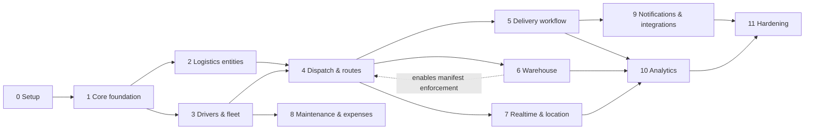

# fleetflow-api: Development Phases

Statuses: `NOT STARTED` · `IN PROGRESS` · `BLOCKED` · `COMPLETED`. A phase becomes `COMPLETED` only when its acceptance criteria have been verified and the owner has approved the checkpoint. Update the status here **and** in [memory.md](memory.md).

**Current phase: Phase 4, IN PROGRESS** (4-PR plan approved 2026-11-26). Phase 0 COMPLETED 2026-11-22; Phase 1 COMPLETED 2026-11-23; Phase 2 COMPLETED 2026-11-24; Phase 3 COMPLETED 2026-11-26.

## Ordering and dependencies

The suggested order from PROJECT.md is kept, with one change: **manifest/loading verification** is specified in Phase 4 but only **enforced** once Phase 6 delivers loading scans (a feature flag, off until then). Reason: routes and dispatch (needed by both clients) shouldn't wait for warehouse work, and direct pickup-and-deliver routes don't need a warehouse at all.

Client dependencies (for coordination): admin Phase 1 needs API Phase 1; driver-app Phase 3 needs API Phase 4; driver-app Phase 5 needs API Phase 5; admin live map and driver GPS need API Phase 7.

---

## Phase 0: Architecture & Project Setup

- **Status**: COMPLETED (2026-11-22; PR #1 merged after owner review, CI green on the PR and on `main`)
- **Goal**: a runnable, empty, well-tooled Django project that matches architecture.md.
- **Scope / deliverables**: owner decisions on the NEEDS APPROVAL items (Django version D-API-1, admin auth D-API-2, hosting: all decided 2026-11-22); `pyproject.toml` with pinned dependencies; settings split; Docker Compose (api, worker, beat, postgres-postgis, redis; object storage moved to Phase 3, see memory D-API-9); `.env.example`; ruff and mypy config; pytest plus pytest-django against PostGIS; `/health/live` and `/health/ready`; CI (lint, type check, tests, `makemigrations --check`, `pip-audit`); drf-spectacular serving an empty schema; `apps/core` with base models only.
- **Dependencies**: owner approval of these docs.
- **Acceptance**: `docker compose up` gives healthy services; `/health/ready` returns 200 and shows 503 when the DB is stopped; CI is green on a PR; one smoke test runs against PostGIS (`SELECT postgis_version()`).
- **Required tests**: health endpoints (up and DB down); settings load per environment; PostGIS extension present.
- **Out of scope**: any domain model, auth, business endpoint.
- **Checkpoint**: owner reviews the repo layout and CI before Phase 1.

## Phase 1: Core Foundation

- **Status**: COMPLETED (2026-11-23). PRs #2–#5 merged with CI green; security review recorded in memory.md; owner checkpoint passed.
- **Goal**: secure multi-tenant identity.
- **Scope**: Company, Branch, User (email login), Role/Permission seed, JWT login/refresh/logout with rotation and blacklist, password reset, throttles, tenant-scoped base manager, RBAC permission classes, AuditLog, error envelope, idempotency middleware, tenant isolation sweep test harness.
- **Dependencies**: Phase 0.
- **Acceptance**: the full auth scenario table (architecture §26.4) passes; the tenant sweep runs in CI; the OpenAPI schema has auth endpoints; services and permissions coverage is ≥ 95 %.
- **Required tests**: auth table, role matrix, idempotency replay and key reuse, audit entries on login and permission change.
- **Out of scope**: customers, shipments, SSO, custom roles, API keys.
- **Checkpoint**: security review of the auth flow before Phase 2.

## Phase 2: Core Logistics Entities

- **Status**: COMPLETED (2026-11-24). PRs #7–#9 merged with CI green on `main`; the owner signed off the shipment status enum (12 statuses, §11 transitions) at the checkpoint; security reviews recorded in memory.md. Decisions D-API-18 to D-API-24.
- **Approved delivery plan (3 PRs, merged in order):**
  1. **`feature/api-geo-customers`**
     - GeoDjango engine with GDAL in the image and CI; checks run inside the container.
     - Company `currency` (ISO 4217) and `timezone` (IANA); Branch `code`.
     - Per-company `ServiceType` (code, name, max weight, max dimensions), seeded for new companies and by a data migration for existing ones.
     - `Customer` (individual or business, archived rather than deleted) and its address book, with list/create/update/archive APIs.
     - `customers.view` and `customers.manage` seeded with the role table in D-API-21. The branch-scoping helper and the `shipments.*` permissions moved to PR 2, and `service_types.manage` to the PR that adds its endpoint (D-API-22).
  2. **`feature/api-shipments`**
     - `Shipment`, `ShipmentItem` (one row per parcel, with its own barcode) and immutable `ShipmentAddress` snapshots for pickup and delivery.
     - Tracking numbers `FF-<BRANCH>-<seq>` from a locked per-branch counter.
     - Public tracking token: 128-bit, unique, rotatable.
     - Create with a required `Idempotency-Key`; drafts can be edited and hard-deleted (audited).
     - List and detail with django-filter filters and branch scoping; the first `TrackingEvent`.
     - Branch-scoping helper and the `shipments.*` permissions, including `shipments.all_branches` (moved from PR 1, D-API-22).
  3. **`feature/api-shipment-status`**
     - Transition table and `transition()` with row lock plus `expected_status`.
     - API endpoints for confirm, cancel, recovery and admin correction only; other edges are service-level until their phases.
     - Timeline, nightly consistency check (log only, no auto-fix), public tracking endpoint, and hypothesis property tests.
- **Goal**: shipments can be created and moved through the lifecycle.
- **Scope**: Customer, business account, Address (with PostGIS point and geocode-confidence field; real geocoding provider NEEDS APPROVAL), Shipment, ShipmentItem, tracking-number generator, status machine service, TrackingEvent, public tracking token (read endpoint), shipment list filters, sorting and cursor pagination.
- **Dependencies**: Phase 1.
- **Acceptance**: shipment creation and state-transition scenario tables pass; concurrency test proves a single winner; the status/event consistency check exists.
- **Required tests**: architecture §26.4 Shipment creation and Shipment state transitions (all rows), with hypothesis sequence test.
- **Out of scope**: routes, POD, warehouse scans, pricing.
- **Checkpoint**: owner signs off the status enum (shared contract) before clients build on it.

## Phase 3: Drivers & Fleet

- **Status**: COMPLETED (2026-11-26). PRs #11–#14 merged with CI green on `main` for each merge; acceptance verified at the checkpoint on `main` (`064e75a`); security reviews recorded in memory.md. Decisions D-API-25 to D-API-28.
- **Approved delivery plan (4 PRs, merged in order):**
  1. **`feature/api-uploads`** (merged, PR #11)
     - SeaweedFS in Compose and CI, boto3 (no django-storages), `S3_*` settings, a storage check in `/health/ready`.
     - `core/storage.py`, the generic `uploads` app (presigned PUT with signed size and type, confirm with magic-byte check and lossless EXIF/XMP/IPTC stripping, attach, ETag swap protection, hourly purge of unattached uploads), `uploads.create`.
  2. **`feature/api-fleet`** (merged, PR #12, decisions D-API-26)
     - `Driver` (one-to-one with a user holding the `driver` role) and `Vehicle` (home branch, license category, weight and volume capacity), suspension and out-of-service status with a reason, leave with an overlap constraint, archive.
     - Availability on a date (`available_on` filter and `availability` in responses). Branch scoping shared with shipments, `fleet.view`, `fleet.manage` and `fleet.all_branches`.
  3. **`feature/api-fleet-documents`** (merged, PR #13, decisions D-API-27)
     - Driver and vehicle documents (license with categories, ID, medical, registration, insurance, inspection) attached to uploads, `expires_on` valid through its date in the company timezone, `is_expired` and `expires_before` filters.
     - License category and registration/insurance checks that Phase 4 assignment will call, 5-minute download URLs for `fleet.manage`.
  4. **`feature/api-driver-shifts`** (merged, PR #14, decisions D-API-28)
     - `Shift` start and end with one open shift per driver, `GET /me/driver/`, `/me/shift/start|end/`, `shifts.manage_own`.
     - `driver.profile_inactive` for driver endpoints without an active profile.
- **Goal**: an assignable fleet.
- **Scope**: Driver profile (linked to User), licenses and categories, DriverDocument, Vehicle (capacity weight/volume, category), VehicleDocument, availability (leave, suspension, shifts), document upload via the §19 upload flow (first use of uploads), expiry tracking.
- **Dependencies**: Phase 1 (Phase 2 not required).
- **Acceptance**: availability rules are queryable; uploads are hardened (type, size, private); expired documents are detectable.
- **Required tests**: upload security rows (type mismatch, oversize, unauthorized), availability boundaries, document expiry boundary dates.
- **Out of scope**: assignment to routes, maintenance, fuel, shift breaks and vehicle inspections (Phase 8), expiry alerts (Phase 8).

## Phase 4: Dispatch & Route Operations

- **Status**: IN PROGRESS (plan approved by the owner 2026-11-26; decisions D-API-29)
- **Approved delivery plan (4 PRs, merged in order; new app `apps/dispatch`):**
  1. **`feature/api-routes`**
     - `Route` (branch, `route_date`, nullable driver and vehicle, `sequence_enforced`, `version`, status `planned → assigned → loading → dispatched → in_progress → completed | cancelled`; `loading` unused until Phase 6) and `RouteStop` (one shipment per stop, `pickup` or `delivery`, `sequence`, optional time window, `has_location`; `UNIQUE(route, sequence)` deferrable, `UNIQUE(route, shipment, type)`).
     - List/create/detail/update, add and remove stop, reorder and cancel, with `version` on every change (409 `route.version_conflict`). Pickup-before-delivery, duplicate-stop and sequence rules, at most 300 stops.
     - Shipment status follows the stops: `created|sorted → assigned` on the first stop; back to the previous status on removal or cancellation. This adds the service-level edges `assigned → created` and `assigned → sorted` to the §11 table (owner-approved; the enum is unchanged; CHANGELOG entry).
     - Ungeocoded addresses are allowed and flagged `has_location: false`; invalid coordinates are 400.
     - `dispatch.view`, `dispatch.manage`, `dispatch.all_branches` seeded.
  2. **`feature/api-route-assignment`**
     - `assign` and `unassign` with every §13 rule through the fleet selectors for the route date (driver and vehicle availability, licence category, registration and insurance, one active route per driver and vehicle per date, capacity by weight and volume, `dispatch.override_capacity` with a reason, audited), idempotent repeats, and a single-winner race test.
  3. **`feature/api-dispatch`**
     - Manifest created at dispatch (the expected set; `MANIFEST_ENFORCEMENT` off until Phase 6), `dispatch` (409 `route.empty`), the driver's `GET /me/routes/`, `GET /me/routes/{id}/` (own routes only) and `POST /me/routes/{id}/start/` (needs an open shift and a dispatched route; shipments become `out_for_delivery`), and `dispatch.reassign_active` for in-progress reassignment.
  4. **`feature/api-route-suggest`**
     - `suggest-order`: greedy nearest neighbour on straight-line distance, respecting pickup-before-delivery, ungeocoded stops kept last in manual order, not applied until the client reorders (`optimization: "nearest_neighbour"`).
- **Goal**: dispatchers can build, assign and dispatch routes.
- **Scope**: Route, RouteStop, sequencing, versioned updates, assignment service with all rules, manifest model, dispatch action, driver "my route" endpoints, nearest-neighbour suggestion, manifest enforcement flag (off until Phase 6).
- **Dependencies**: Phases 2 and 3.
- **Acceptance**: assignment and dispatch scenario tables pass; stale-version 409 works; driver sees only their own routes.
- **Required tests**: architecture §26.4 Driver & vehicle assignment and Dispatch & route operations (the notification and `time_window_risk` rows are deferred, D-API-29).
- **Out of scope**: external optimizer, live tracking, POD, notifications (Phase 9), planned ETA and the `time_window_risk` warning (Phase 7), planned/actual distance and duration (Phase 7).
- **Checkpoint**: publish the route/stop contract to admin and driver-app memories.

## Phase 5: Delivery Workflow

- **Status**: NOT STARTED
- **Goal**: drivers can complete pickups and deliveries with proof.
- **Scope**: stop arrive/complete, pickup confirmation, delivery attempts, POD (OTP, signature, photo, recipient name) with policy per service type, OTP generation/verify/resend/lock, geofence flag, exceptions plus resolutions, retry, return-to-warehouse, returned_to_sender, offline-sync-friendly idempotent endpoints.
- **Dependencies**: Phase 4.
- **Acceptance**: POD and exception tables pass; replaying offline queued requests produces no duplicates.
- **Required tests**: architecture §26.4 Proof of delivery and Delivery exceptions (all rows).
- **Out of scope**: SMS provider for OTP delivery (stub channel plus email until Phase 9 — NEEDS APPROVAL on interim channel).

## Phase 6: Warehouse Operations

- **Status**: NOT STARTED
- **Scope**: Warehouse, receiving, sort, stage, load and unload scans, misroute detection, manifest reconciliation, enabling manifest enforcement on dispatch, CSV/XLSX bulk shipment import plus async job report.
- **Dependencies**: Phase 4.
- **Acceptance / tests**: architecture §26.4 Warehouse table; dispatch blocked on manifest mismatch.
- **Out of scope**: WMS bin locations, inventory.

## Phase 7: Real-time & Location

- **Status**: NOT STARTED
- **Scope**: Channels setup, WS tickets, groups, event registry and documented event table; ping ingestion, last-known location, freshness, retention job; simple ETA; public tracking with location policy.
- **Dependencies**: Phase 4 (shifts from Phase 3).
- **Acceptance / tests**: architecture §26.4 Tracking & GPS table; WS isolation test; ingest load smoke test (500 drivers simulated).
- **Out of scope**: routing-engine ETA, geofence automation.

## Phase 8: Maintenance & Expenses

- **Status**: NOT STARTED
- **Scope**: maintenance records and schedules, fuel records, anomaly flagging, vehicle cost aggregation, expiry and due alerts.
- **Dependencies**: Phase 3.
- **Tests**: architecture §26.4 Maintenance & fuel table.

## Phase 9: Notifications & Integrations

- **Status**: NOT STARTED
- **Scope**: outbox dispatcher, providers (email, push via Expo push service, SMS provider NEEDS APPROVAL: paid), templates per company, customer notifications at key statuses, outgoing webhooks with signing and retries, integration API keys.
- **Dependencies**: Phase 5.
- **Tests**: architecture §26.4 Notifications & background jobs table; webhook signature verification; retry exhaustion.

## Phase 10: Analytics & Reporting

- **Status**: NOT STARTED
- **Scope**: KPI definitions doc (delivery rate, on-time rate, first-attempt success, cost per delivery, utilization), report endpoints, async exports.
- **Dependencies**: Phases 5, 6, 7.
- **Tests**: architecture §26.4 Reports & analytics table.

## Phase 11: Hardening & Production Readiness

- **Status**: NOT STARTED
- **Scope**: security review (ASVS L2 checklist), locust performance tests against targets, metrics and alerting, backup/PITR and restore drill, CI/CD to staging/production, malware scanning decision, Django upgrade evaluation.
- **Dependencies**: all MVP phases.
- **Acceptance**: targets in architecture §22 met; restore drill documented; zero open high-severity issues.
